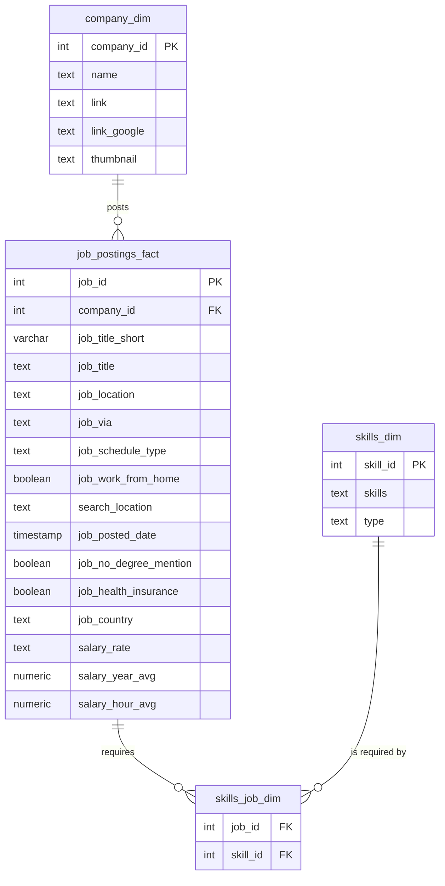

# SQL Data Job Market Analysis 📊

Analyzing 2023's data job postings to find out what pays the most, what's in demand,
and where the two overlap — using nothing but PostgreSQL.

## Background

The data job market is flooded with advice about "what skills to learn," most of it
anecdotal. This project replaces the guesswork with a SQL-based analysis of **~790,000
real job postings** to answer, with evidence:

- 💰 What are the top-paying Data Analyst jobs?
- 🛠️ What skills do those top-paying jobs require?
- 📈 What skills are most *in demand* for Data Analysts?
- 💵 Which skills are tied to the *highest* salaries?
- 🎯 What's the optimal skill to learn — i.e., high demand **and** high pay?

Dataset: job postings, companies, and skills scraped from online job boards in 2023,
sourced from [Luke Barousse's SQL Course](https://lukebarousse.com/sql).

## Tools Used

- **SQL** — the core of the analysis; every insight below comes from a query in this repo
- **PostgreSQL** — database engine used to store and query ~790K job postings
- **Git & GitHub** — version control and project sharing
- **VS Code** — SQL development and query execution

## Database Schema

A star-schema-style layout: one fact table (`job_postings_fact`) surrounded by
dimension tables for companies and skills, linked through a bridge table for the
many-to-many relationship between jobs and skills.



## The Analysis

Each query in [`queries/`](queries/) targets a specific question about the Data Analyst
job market. Here's what the data showed.

### 1. Top-paying Data Analyst jobs

Filtered remote Data Analyst positions by highest salary. See
[`queries/1_top_paying_jobs.sql`](queries/1_top_paying_jobs.sql).

```sql
SELECT
    job_id,
    job_title,
    name AS company_name,
    job_location,
    job_schedule_type,
    salary_year_avg,
    job_posted_date
FROM job_postings_fact
LEFT JOIN company_dim ON job_postings_fact.company_id = company_dim.company_id
WHERE
    job_title_short = 'Data Analyst'
    AND job_location = 'Anywhere'
    AND salary_year_avg IS NOT NULL
ORDER BY salary_year_avg DESC
LIMIT 10;
```

| Job Title                              | Company   | Salary ($/yr) |
|-----------------------------------------|-----------|---------------|
| Data Analyst                            | Mantys    | 650,000       |
| Director of Analytics                   | Meta      | 336,500       |
| Associate Director- Data Insights       | AT&T      | 255,830       |
| Data Analyst, Marketing                 | Pinterest | 232,423       |
| Data Analyst (Hybrid/Remote)            | UCLA Health | 217,000     |

**Takeaway:** Salaries for remote Data Analyst roles ranged from $184K to $650K —
"Data Analyst" is a title, not a pay grade. Seniority and specialization
(Director, Marketing Analytics, Principal) drive the biggest jumps.

### 2. Skills behind the top-paying jobs

Joined the top 10 jobs above against their required skills. See
[`queries/2_top_paying_job_skills.sql`](queries/2_top_paying_job_skills.sql).

**Takeaway:** **SQL** appears in almost every top-paying posting, with **Python**
close behind. Beyond the core two, the highest earners also ask for BI tools
(Tableau, Excel) and cloud/warehouse platforms (AWS, Azure, Snowflake) —
suggesting the $200K+ roles want analysts who can also operate in cloud data stacks.

### 3. Most in-demand skills (overall)

Counted skill frequency across *all* Data Analyst postings. See
[`queries/3_top_demanded_skills.sql`](queries/3_top_demanded_skills.sql).

| Skill     | Demand Count |
|-----------|-------------:|
| SQL       | 92,628       |
| Excel     | 67,031       |
| Python    | 57,326       |
| Tableau   | 46,554       |
| Power BI  | 39,468       |

**Takeaway:** SQL and Excel are the baseline — the two most-requested skills by a wide
margin. Python, Tableau, and Power BI round out the modern analyst toolkit.

### 4. Top-paying skills

Ranked skills by average salary (min. 10 postings, to filter out one-off outliers).
See [`queries/4_top_paying_skills.sql`](queries/4_top_paying_skills.sql).

| Skill      | Avg. Salary ($/yr) |
|------------|--------------------:|
| Kafka      | 129,999              |
| PyTorch    | 125,226              |
| Perl       | 124,686              |
| TensorFlow | 120,647              |
| Cassandra  | 118,407              |

**Takeaway:** The highest *average* salaries skew toward data engineering and ML
tooling (Kafka, PyTorch, TensorFlow) rather than classic BI tools — analysts who
can cross into engineering/ML territory command a premium.

### 5. Optimal skills to learn (demand + salary)

Combined demand and average salary to find the sweet spot. See
[`queries/5_optimal_skills.sql`](queries/5_optimal_skills.sql).

| Skill   | Demand Count | Avg. Salary ($/yr) |
|---------|-------------:|--------------------:|
| Kafka   | 40           | 129,999              |
| Airflow | 71           | 116,387              |
| Scala   | 59           | 115,480              |
| Linux   | 58           | 114,883              |
| Confluence | 62        | 114,153              |

**Takeaway:** Skills that balance meaningful demand *and* high pay — Airflow, Scala,
Linux — point to **pipeline and orchestration know-how** as a high-leverage,
underrated investment for data analysts looking to stand out and increase earning
potential, beyond the standard SQL/Excel/Tableau stack.

## What I Learned

- **Complex query building:** multi-table joins and CTEs (`WITH` clauses) to chain
  filtering, aggregation, and ranking into a single readable query.
- **Data aggregation:** `GROUP BY`, `COUNT()`, and `AVG()` to turn ~790K individual
  rows into digestible, rankable insights.
- **Analytical thinking:** translating an open-ended business question ("what skill
  should I learn?") into a precise, testable SQL query — and reading the result back
  into a real-world recommendation.

## How to Reproduce This

1. Install PostgreSQL and load the schema:
   ```bash
   psql -f create_database.sql
   psql -d sql_course -f create_tables.sql
   ```
2. Download the dataset CSVs from the [source link](https://lukebarousse.com/sql)
   above and place them in a `csv_files/` folder in the project root.
3. Load the data:
   ```bash
   psql -d sql_course -f modify_tables.sql
   ```
4. Run any query in [`queries/`](queries/) against the `sql_course` database.

## Project Structure

```
.
├── create_database.sql      # Creates the sql_course database
├── create_tables.sql        # Defines schema: companies, skills, jobs, job-skills
├── modify_tables.sql        # Loads CSV data into the tables
├── view_all_data.sql        # Quick sanity-check queries after loading
├── queries/
│   ├── 1_top_paying_jobs.sql
│   ├── 2_top_paying_job_skills.sql
│   ├── 3_top_demanded_skills.sql
│   ├── 4_top_paying_skills.sql
│   └── 5_optimal_skills.sql
└── csv_files/                # Raw data (not tracked — see .gitignore)
```

## Connect

**Aman Ubhi** — [GitHub](https://github.com/amanubhi)

---
*Built as part of a hands-on SQL/data analytics learning project using a real-world
job postings dataset.*
