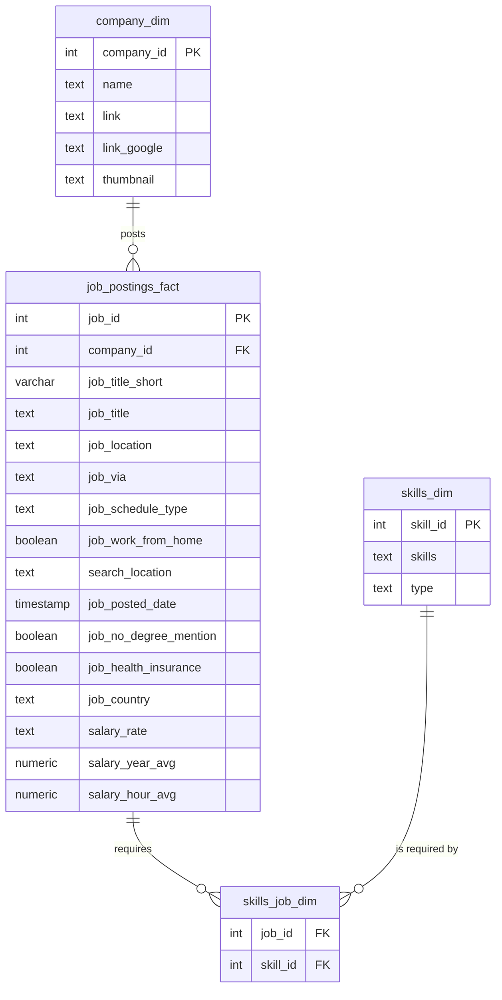

# SQL Data Job Market Analysis 📊

Analyzing real data-job postings to find out what pays the most, what's in demand,
and where the two overlap — using nothing but PostgreSQL.

This project now spans **two dataset snapshots** so the analysis itself can be
checked for drift over time: an original 2023 snapshot, and a much larger
snapshot received in November 2026 whose postings actually run from January 2023
through October 2026. Both are documented below, with results kept side by side
rather than overwritten, so the comparison is auditable.

## Background

The data job market is flooded with advice about "what skills to learn," most of it
anecdotal. This project replaces the guesswork with a SQL-based analysis of
**real job postings** to answer, with evidence:

- 💰 What are the top-paying Data Analyst jobs?
- 🛠️ What skills do those top-paying jobs require?
- 📈 What skills are most *in demand* for Data Analysts?
- 💵 Which skills are tied to the *highest* salaries?
- 🎯 Among salary-disclosing postings, which skills are most in demand (with salary
  as a tiebreaker) — not a combined "best of both" score?

Dataset: job postings, companies, and skills scraped from online job boards,
sourced from [Luke Barousse's SQL Course](https://lukebarousse.com/sql).

## Tools Used

- **SQL** — the core of the analysis; every insight below comes from a query in this repo
- **PostgreSQL** — database engine used to store and query the job postings
- **Git & GitHub** — version control and project sharing
- **VS Code** — SQL development and query execution

## Datasets

| | Original dataset (`sql_course`) | Updated dataset (`sql_course_bonus`) |
|---|---|---|
| Received | original course download | November 2026 (folder: `csv_files_Nov_2026/`) |
| **Actual posting date range** (verified via `MIN`/`MAX(job_posted_date)`) | 2022‑12‑31 → 2023‑12‑31 | **2023‑01‑01 → 2026‑10‑31** |
| Job postings | 787,686 | 2,008,270 |
| Companies | 140,033 | 259,031 |
| Skills | 259 | 263 |
| Job↔skill links | 3,669,604 | 8,956,670 |
| Postings with a disclosed salary | 22,034 (2.80%) | 103,533 (5.16%) |
| Data Analyst postings | 196,593 | 502,810 |
| Data Analyst postings with a disclosed salary | 5,463 (2.78%) | 29,126 (5.79%) |

**Important:** the folder name `csv_files_Nov_2026` is when the file was *received*,
not when the postings were made — the data inside spans almost four years. Don't
assume a dataset's date range from its folder/file name; always verify with
`MIN`/`MAX` on the actual timestamp column.

Both databases are built from the same schema (see
[Database Schema](#database-schema)) and kept **separate** on purpose —
`sql_course` is untouched, and the new data lives in `sql_course_bonus` — so
results below can be directly compared rather than silently overwritten.

Setup for the updated dataset:
```bash
createdb sql_course_bonus
psql -d sql_course_bonus -f create_tables_bonus.sql
psql -d sql_course_bonus -v data_dir="$(pwd)/csv_files/csv_files_Nov_2026" -f load_data_bonus.sql
```
See [`create_tables_bonus.sql`](create_tables_bonus.sql) and
[`load_data_bonus.sql`](load_data_bonus.sql) for details — the load script takes
the data directory as a `psql` variable rather than a hardcoded path, so it works
on any machine/checkout.

## Database Schema

Identical for both datasets: a star-schema-style layout with one fact table
(`job_postings_fact`) surrounded by dimension tables for companies and skills,
linked through a bridge table for the many-to-many relationship between jobs and
skills.



## The Analysis

Each query in [`queries/`](queries/) targets a specific question about the Data
Analyst job market. All five were run against **both** databases; full output for
each is exported under [`results/`](results/) so every number below can be
checked against its source. Headline numbers are from the updated (larger, more
current) dataset, with the original 2023-only dataset noted for comparison.

### 1. Top-paying Data Analyst jobs (remote only)

Filtered remote (`job_location = 'Anywhere'`) Data Analyst positions by highest
disclosed salary. See
[`queries/1_top_paying_jobs.sql`](queries/1_top_paying_jobs.sql) ·
[updated results](results/dataset_2023-01_to_2026-10_updated/1_top_paying_jobs.csv) ·
[original results](results/dataset_2022-12_to_2023-12_original/1_top_paying_jobs.csv).

| Job Title (raw `job_title`) | Company | Salary ($/yr) | Posted |
|---|---|---:|---|
| Data Analyst | Mantys | 650,000 | 2023-02 |
| Data Analyst (Microsoft Dynamics 365 ERP) | The Legends Agency | 570,000 | 2026-01 |
| Applied Scientist | Recruitment Room | 504,000 | 2026-10 |
| Analytics Engineer – Playback Data (L5) | Netflix | 445,000 | 2025-06 |
| Analytics Engineer (L5) – Live QoE | Netflix | 445,000 | 2024-12 |
| Senior Distinguished Technologist – Pre-Sales AI & Data Center Networking | Hewlett Packard Enterprise | 441,000 | 2026-09 |
| Financial & Data Analyst – Pricing | Siemens | 385,000 | 2024-05 |
| Executive VP – Data Center (Middle East) | Energi People | 350,000 | 2026-09 |
| Director of Analytics | Meta | 336,500 | 2023-08 |

**Takeaway:** the top end moved from $184K–$650K (2023 only) to $336K–$650K across
the fuller 2023–2026 window — the ceiling didn't change (Mantys' $650K posting is
in both snapshots, re-scraped under a new `job_id`), but more very-high-paying
postings showed up as the window widened. **Caveat:** several of these raw titles
(*Applied Scientist*, *Senior Distinguished Technologist*) don't read like "Data
Analyst" roles — they're bucketed into `job_title_short = 'Data Analyst'` by the
source dataset's own title classifier, not by us. Treat `job_title_short` as the
dataset's categorization, not a guarantee every row is a literal analyst job.

### 2. Skills behind the top-paying jobs

Joined the top 10 jobs above against their required skills. See
[`queries/2_top_paying_job_skills.sql`](queries/2_top_paying_job_skills.sql) ·
[updated results](results/dataset_2023-01_to_2026-10_updated/2_top_paying_job_skills.csv).

**Takeaway:** **SQL** and **Python** still anchor the list, consistent with the
original snapshot. The specific secondary skills shifted with the job mix — e.g.
Netflix's Analytics Engineer postings pull in Scala/TypeScript/Go, and the
Applied Scientist posting pulls in scikit-learn/pandas — a reminder that "top
paying" skill lists are sensitive to which specific jobs happen to be at the top
in a given snapshot.

### 3. Most in-demand skills (across all Data Analyst postings)

Counted skill frequency across *all* Data Analyst postings, regardless of
location or salary disclosure. See
[`queries/3_top_demanded_skills.sql`](queries/3_top_demanded_skills.sql).

| Skill | Updated dataset (2023–2026) | Original dataset (2023 only) |
|---|---:|---:|
| SQL | 225,434 | 92,628 |
| Excel | 164,955 | 67,031 |
| Python | 146,309 | 57,326 |
| Tableau | 112,946 | 46,554 |
| Power BI | 111,399 | 39,468 |

**Takeaway:** the ranking is identical in both snapshots — SQL and Excel are the
baseline, Python/Tableau/Power BI round out the toolkit — and counts scaled up
roughly in proportion to the ~2.5x growth in total postings. The ranking is
stable; only the volume changed.

### 4. Top-paying skills

Ranked skills by average salary among Data Analyst postings with a disclosed
salary (min. 10 postings, to filter out one-off outliers). See
[`queries/4_top_paying_skills.sql`](queries/4_top_paying_skills.sql).

| Updated dataset (2023–2026) | Avg. Salary | Original dataset (2023 only) | Avg. Salary |
|---|---:|---|---:|
| Hugging Face | 156,472 | Kafka | 129,999 |
| Terraform | 152,572 | PyTorch | 125,226 |
| DynamoDB | 140,938 | Perl | 124,686 |
| Node.js | 135,495 | TensorFlow | 120,647 |
| GraphQL | 132,042 | Cassandra | 118,407 |

**Takeaway:** this list changed substantially, not just in magnitude but in
*composition* — Hugging Face, GraphQL, and DynamoDB didn't place in the original
2023-only top 10 at all. That tracks with the extended window reaching into
2024–2026, when AI-tooling and modern web-stack skills became more common (and
more highly paid) in postings classified as "Data Analyst." **This is one
dataset's 10 highest averages among a 5%-salary-disclosure sample — read it as a
directional signal, not a definitive salary survey** (see
[Data Quality & Caveats](#data-quality--caveats)).

### 5. Skill demand among salary-disclosing postings (salary as tiebreaker)

**Note:** this query was updated to match the course's revised version. It is a
**demand ranking**, not a combined demand+salary score — skills are sorted by
`demand_count` first, and `avg_salary` only breaks ties between skills with equal
demand. See [`queries/5_optimal_skills.sql`](queries/5_optimal_skills.sql) ·
[updated results](results/dataset_2023-01_to_2026-10_updated/5_optimal_skills.csv).

| Skill | Demand Count | Avg. Salary ($/yr) |
|---|---:|---:|
| SQL | 13,462 | 101,319 |
| Excel | 10,662 | 88,780 |
| Python | 8,918 | 105,505 |
| Tableau | 7,446 | 100,857 |
| Power BI | 6,262 | 96,542 |
| R | 4,823 | 102,465 |

**Takeaway:** among postings that disclose a salary, the most in-demand skills
are the same familiar core (SQL, Excel, Python, Tableau, Power BI, R) — there's
no hidden "optimal" niche skill once you restrict to the salary-disclosing
subset, because that subset is still dominated by the same mainstream postings.
Don't mistake *demand within a 5% sample* for *demand across the market* — see
below.

## Remote-Only vs. All-Location Analysis

Queries 1–2 filter to `job_location = 'Anywhere'` (fully remote); queries 3–5
intentionally look across **all** locations. This is why, for example, SQL's
demand count in query 3 (225,434, all locations) is far larger than it would be
if restricted to remote-only postings — the two numbers answer different
questions ("what's in demand everywhere" vs. "what's in demand on-site + hybrid +
remote combined") and shouldn't be compared directly. Query 5 keeps its
remote-only filter as a commented-out line (`-- AND job_work_from_home = TRUE`)
specifically so it can be toggled on to answer the narrower, remote-specific
version of the same question.

## Demand Among All Postings vs. Demand Among Salary-Disclosing Postings

Query 3 counts demand across *every* Data Analyst posting (502,810 in the
updated dataset). Query 5 counts demand only among the *subset that discloses a
salary* (29,126 — 5.79% of all Data Analyst postings). SQL's demand count drops
from 225,434 (query 3) to 13,462 (query 5) — almost exactly the ~6% disclosure
rate, confirming the drop is sampling, not a change in SQL's actual popularity.
**Any "top skill" list built from query 5 (or query 4) is only representative of
the ~5% of postings that chose to disclose a salary** — not the market as a
whole.

## Data Quality & Caveats

- **Salary disclosure is rare and non-random.** Only ~5% of postings disclose an
  annual salary. Companies that disclose (often due to state/local pay-transparency
  laws) are not a random sample of all employers — so every "top-paying skill"
  finding above reflects a biased subset, and **correlation between a skill and a
  high average salary is not evidence that learning the skill causes a higher
  salary.** Seniority, company, and role scope are confounders that this schema
  doesn't isolate.
- **`job_id` is not a stable identifier across dataset snapshots.** The same
  real-world Mantys posting appears in both datasets at $650,000, but as
  `job_id = 226942` (original) vs. `job_id = 138072` (updated), with a
  timestamp that differs by 11 seconds. Treat `job_id` as a snapshot-local key,
  not a persistent record ID.
- **`job_title_short` is the source dataset's own classification**, not a
  re-derivation done here — e.g. "Applied Scientist" and "Senior Distinguished
  Technologist" postings are both labeled `job_title_short = 'Data Analyst'` in
  the updated dataset (see query 1). Results are only as clean as that upstream
  classifier.
- **A few skill names exist twice under different `skill_id`s**, with identical
  demand/salary stats (e.g. `sas` appears as both `skill_id 8` [type
  `programming`] and `skill_id 194` [type `analyst_tools`] in the updated
  dataset — present in the original dataset too, at different IDs). This is a
  pre-existing upstream data issue, not introduced by the November 2026 update;
  it means any top-N skills list can show the same skill twice.
- **Referential integrity was verified, not assumed:** every `company_id` in
  `job_postings_fact`, and every `job_id`/`skill_id` in `skills_job_dim`, resolves
  to a real row in the corresponding dimension table in both databases — zero
  orphaned foreign keys.

## What I Learned

- **Complex query building:** multi-table joins and CTEs (`WITH` clauses) to chain
  filtering, aggregation, and ranking into a single readable query.
- **Data aggregation:** `GROUP BY`, `COUNT()`, and `AVG()` to turn large row counts
  into digestible, rankable insights.
- **Dataset auditing:** validating row counts, foreign-key integrity, and actual
  date coverage against a vendor-supplied file/folder name — rather than trusting
  it — before drawing conclusions from a new data drop.
- **Analytical thinking:** translating an open-ended business question ("what skill
  should I learn?") into a precise, testable SQL query, understanding exactly what
  that query's filters do and don't cover (remote vs. all-location, all postings
  vs. salary-disclosing only), and reading the result back into a real-world,
  appropriately-hedged recommendation.

## How to Reproduce This

**Original dataset (`sql_course`):**
```bash
psql -f create_database.sql
psql -d sql_course -f create_tables.sql
```
Download the dataset CSVs from the [source link](https://lukebarousse.com/sql)
above, place them in a `csv_files/` folder in the project root, then:
```bash
psql -d sql_course -f modify_tables.sql
```

**Updated dataset (`sql_course_bonus`):**
```bash
createdb sql_course_bonus
psql -d sql_course_bonus -f create_tables_bonus.sql
psql -d sql_course_bonus -v data_dir="$(pwd)/csv_files/csv_files_Nov_2026" -f load_data_bonus.sql
```

Then run any query in [`queries/`](queries/) against either database, e.g.:
```bash
psql -d sql_course_bonus -f queries/5_optimal_skills.sql
```

## Project Structure

```
.
├── create_database.sql       # Creates the sql_course database
├── create_tables.sql         # Defines schema for sql_course (original dataset)
├── create_tables_bonus.sql   # Same schema, for sql_course_bonus (updated dataset)
├── modify_tables.sql         # Loads csv_files/ into sql_course
├── load_data_bonus.sql       # Loads csv_files/csv_files_Nov_2026/ into sql_course_bonus
├── view_all_data.sql         # Quick sanity-check queries after loading
├── queries/
│   ├── 1_top_paying_jobs.sql
│   ├── 2_top_paying_job_skills.sql
│   ├── 3_top_demanded_skills.sql
│   ├── 4_top_paying_skills.sql
│   └── 5_optimal_skills.sql
├── results/                              # Exported query output, one subfolder per dataset
│   ├── dataset_2022-12_to_2023-12_original/
│   └── dataset_2023-01_to_2026-10_updated/
└── csv_files/                 # Raw data (not tracked — see .gitignore)
    └── csv_files_Nov_2026/
```

## Connect

**Aman Ubhi** — [GitHub](https://github.com/amanubhi)

---
*Built as part of a hands-on SQL/data analytics learning project using real-world
job postings datasets.*
